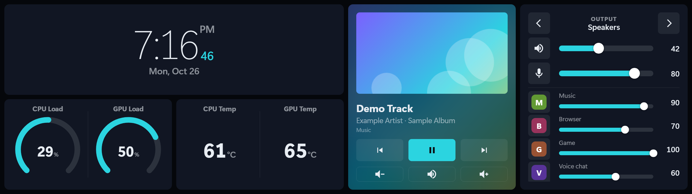
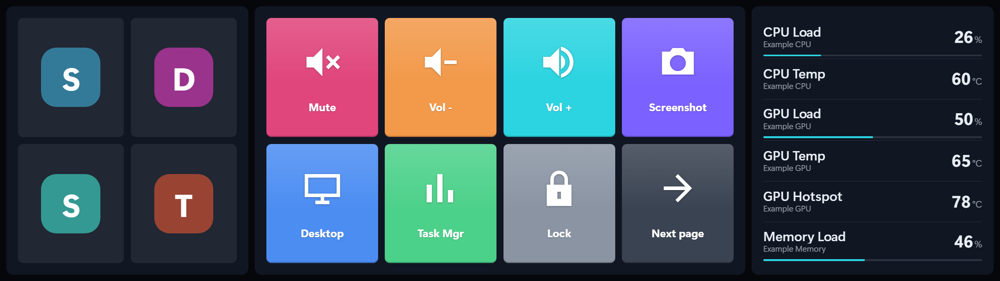
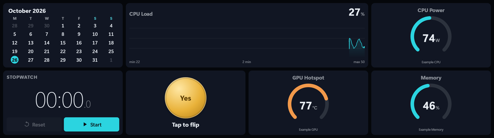
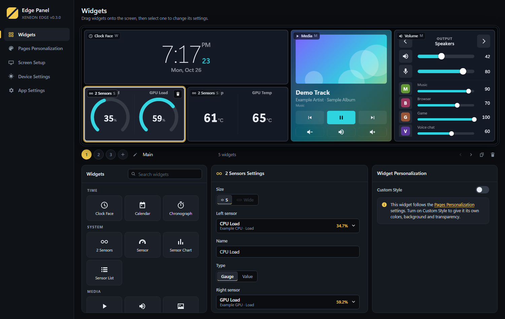

# Edge Panel

A lightweight, touch-first dashboard for the **Corsair XENEON EDGE** 14.5" touchscreen. It runs **without iCUE** and is built to work like iCUE's widget screen: pages you swipe between, a widget catalog, per-widget settings and personalization.





## Why

With iCUE, the Edge sometimes loses its widgets when the main monitor is turned off and never gets them back. Edge Panel fixes that and keeps the Edge as a dedicated touch panel:

- **Finds the Edge by its EDID name** (`XENEON EDGE`), not by display index, and re-pins itself whenever the display topology changes.
- **Keeps the physical mouse out of the Edge** (block cursor access). Touch and pen still work, because Windows tags them with `MI_WP_SIGNATURE`.
- **Keeps other windows off the Edge.** App windows that land there move back to the main display.
- **Never steals focus.** Touching the panel, including the virtual keyboard and touchpad, leaves your game or app in the foreground.
- **Desktop mode** turns the Edge back into a normal monitor with one hotkey. If the Edge is the only display left, the mouse guard turns itself off.

## Widgets

Each page is a 4 × 2 grid. Widgets come in sizes **S** (1×1), **Wide** (2×1), **M** (1×2), **L** (2×2) and **XL** (the full page).

| Category | Widgets |
| --- | --- |
| Time | Clock Face (digital, big seconds, analog, flip; 12/24h; time zone), Calendar, Chronograph (stopwatch and timer) |
| System | 2 Sensors, Sensor (gauge or value), Sensor Chart, Sensor List. These can use any sensor LibreHardwareMonitor sees: CPU, GPU, RAM, motherboard, drives, network, fans and AIO coolers |
| Media | Media (album art, playback controls), Volume (output device switcher, mic, per-app volume mixer), Image / Video, Slideshow, YouTube Video |
| Web | Web URL, iFrame (custom HTML), Twitch Chat, SimHub, Weather, AQI (Weather and AQI use [Open-Meteo](https://open-meteo.com), no API key) |
| Control | Stream Deck (docks Elgato's Virtual Stream Deck with your own profile), Launch App (real app icons), Button Deck (keystrokes, apps, media keys, URLs, typed text, page switching), Virtual Keyboard, Virtual Touchpad |
| Fun | Decision Coin |

## Settings

Open the settings window by left-clicking the tray icon, or right-click it and choose **Settings…**. Changes apply to the Edge right away.



- **Widgets**: a live preview of the Edge, page tabs (add, rename, duplicate, reorder, delete), a searchable widget catalog, the selected widget's settings, and per-widget personalization (colors, background image, transparency). Drag a widget from the catalog onto an empty cell. Drag widgets around the preview to move them.
- **Pages Personalization**: background color or image, text, accent and widget colors, transparency, and corner radius. You can set these globally or per page.
- **Screen Setup**: display mode (widgets or desktop), hotkeys for switching mode and changing pages (default `Ctrl+Alt+E`, `Ctrl+Alt+Left/Right`), block cursor access, keep windows off the Edge, and re-detect the Edge.
- **Device Settings**: brightness, contrast and RGB gains through DDC/CI, plus restore to default.
- **App Settings**: start with Windows, run as administrator (CPU temperatures), sensor refresh rate and developer tools.

The tray menu has quick toggles for desktop mode, block mouse, keep windows off the Edge and start with Windows, plus re-detect, open log and exit.

## Not supported

These iCUE features need a vendor SDK or Windows features that are unavailable to apps like this one:

- **iCUE's own Stream Deck device** is private to iCUE. The **Stream Deck** widget uses Elgato's Virtual Stream Deck instead (Stream Deck 7+, *Add Virtual Device*). It shows your own profile and resizes the keys to fill the widget.
- **FPS counter** needs PresentMon or RTSS.
- **Windows notifications** require package identity.
- **Auto rotation**: rotate the Edge in Windows display settings. The panel switches to a portrait layout by itself.

## Install

See the **[installation guide](docs/INSTALL.md)**, which covers building, installing to Program Files, first setup, the Stream Deck widget and uninstalling.

The short version, which needs the [.NET 10 SDK](https://dotnet.microsoft.com/download/dotnet/10.0). Clone and build:

```bash
git clone https://github.com/K4m0/edge-panel.git
```

```bash
cd edge-panel
```

```bash
dotnet publish src/EdgePanel/EdgePanel.csproj -c Release -o publish
```

Then, from PowerShell opened as administrator:

```powershell
powershell -NoProfile -ExecutionPolicy Bypass -File scripts\install.ps1
```

## Security and privacy

- **No telemetry.** Edge Panel sends nothing anywhere. The only network requests are the ones made by the widgets you add: weather and AQI (Open-Meteo), YouTube, Twitch, and the Web URL widget.
- **Embedded web content is isolated.** Only Edge Panel's own pages can be the top-level document and send commands to the app. Embedded sites are sandboxed, and they can't navigate the panel, open windows or ask for permissions.
- **Admin mode is opt-in and locked down.** Only *Run as administrator* (for CPU temperatures) elevates the app, and it only works when Edge Panel is installed in Program Files, so a non-admin process can't swap the elevated exe. The startup task is registered in memory through the Task Scheduler API. Apps, links and files you open from the panel always start without admin rights.
- Settings stay in `%LOCALAPPDATA%\EdgePanel`.
## How it works

The app is a WPF host with two WebView2 pages: the panel (`wwwroot/index.html`) and the settings editor (`wwwroot/settings.html`). Widgets are plain JavaScript modules in `wwwroot/widgets/`, and `widgets/catalog.js` defines each widget's sizes, defaults and settings form. To add a widget, add a catalog entry and a module. [docs/ARCHITECTURE.md](docs/ARCHITECTURE.md) describes the layout model, the config schema and every message between the host and the pages.

```
src/EdgePanel/
  App.xaml.cs               tray, single instance, settings window
  MainWindow.xaml.cs        panel window, display changes, message routing
  AppConfig.cs              config v3 (pages, theme, hotkeys) + migration
  Audio/                    Core Audio: volume, devices, per-app mixer (NAudio)
  Display/                  monitor detection, window evictor, DDC/CI
  Input/                    mouse guard, hotkeys, SendInput (keys, text, pointer)
  Shell/                    app icons, unelevated launching
  Telemetry/                LibreHardwareMonitor sensors, Windows media session
  wwwroot/                  panel, settings editor, widgets
```

## License

Edge Panel is licensed under the [Apache License 2.0](LICENSE). Copyright 2026 Juan Camilo (K4m0).

You can use, modify and redistribute it, including commercially. If you share it or a modified version, keep the [LICENSE](LICENSE) and [NOTICE](NOTICE) files, which credit the original project. Third-party components are listed in [THIRD-PARTY-NOTICES.md](THIRD-PARTY-NOTICES.md).

Corsair, iCUE and XENEON are trademarks of Corsair. Elgato and Stream Deck are trademarks of Corsair Memory, Inc. This project is not affiliated with or endorsed by Corsair or Elgato.

## Credits

Created by **Juan Camilo ([K4m0](https://github.com/K4m0))**. Built with [Claude Code](https://claude.com/claude-code).